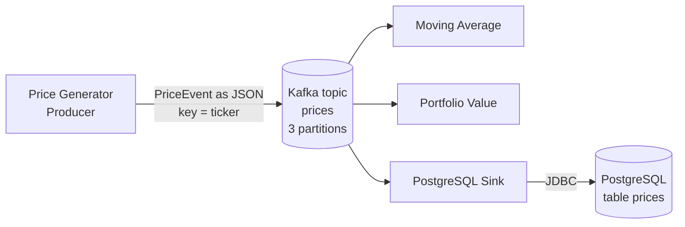

# kafka-market-stream


Real-time market data pipeline built with **Java** and **Apache Kafka**.
 
A price generator continuously publishes stock prices to Kafka. Several independent consumers process the same stream live: a moving average, a live portfolio value, and a sink that stores every event in PostgreSQL for SQL analysis.
 
This project is the streaming counterpart to my Python batch pipeline: instead of loading data once and processing it, events are handled the moment they arrive.
 
> **Completed learning project** (October – November 2026), built step by step during my IT internship. See [Limitations](#limitations) for known simplifications and the [roadmap](#roadmap) for possible next steps.
 
## Architecture
 

 
| Decision | Choice | Reason |
|---|---|---|
| Topics | one topic `prices` for all stocks | adding a new stock requires no consumer changes |
| Partitions | 3 | allows parallel consumers within a consumer group |
| Message key | ticker (e.g. `AAPL`) | all events of one stock land in the same partition, so their order is preserved |
| Message format | JSON | fields are named, so new fields don't break existing consumers |
| Consumers | one consumer group per analysis | every analysis receives the full stream |
| Listeners | `EXTERNAL` (`localhost:9092`) and `INTERNAL` (`kafka:19092`) | apps outside Docker and containers inside the Docker network each need an address that works for them |
| Storage | PostgreSQL, one row per event | events are kept permanently and can be analysed with SQL |
| Event time | stored from the event (`timestamp`), as `TIMESTAMPTZ` | the time the price was created, not when it was processed; time zone safe |
 
### Event
 
```json
{"ticker":"AAPL","timestamp":"2026-10-27T12:39:33.837Z","price":256.9}
```
 
Modelled in Java as an immutable `record PriceEvent(String ticker, Instant timestamp, double price)`. Timestamps are stored in UTC.

## Tech Stack
- Java 17+ (developed on Java 25)
- Apache Kafka (single broker via Docker, KRaft mode)
- Maven
- Jackson 3 (JSON serialization)
- JUnit 5 (unit tests)
- GitHub Actions (CI)
- Docker Compose
- Kafbat UI (web interface for Kafka)
- PostgreSQL 17 (via Docker) with JDBC
- GitHub Codespaces
  
## Getting started
 
Requirements: Docker, Java 17+, Maven. Everything is preinstalled in GitHub Codespaces.
 
**1. Start Kafka**
 
```bash
docker compose up -d
docker ps   # STATUS should show "Up"
```
This also starts **PostgreSQL** (port 5432) and creates the table `prices` from `db/init.sql`.
Additionally **Kafka UI**, a web interface for the broker, starts as well. Open it at [http://localhost:8080](http://localhost:8080) (in Codespaces: *Ports* tab → port 8080 → globe icon). It shows topics, partitions, messages and consumer groups with their lag. It may take up to a minute to start.

> **Codespaces note:** If Kafka UI keeps loading or shows error 500, the Codespace firewall blocks traffic between containers. Run this once per Codespace start:
>
> ```bash
> sudo iptables-legacy -P FORWARD ACCEPT
> docker compose restart kafka-ui
> ```
 
**2. Create the topic**
 
```bash
docker exec -it kafka-market-stream-kafka-1 /opt/kafka/bin/kafka-topics.sh --create --topic prices --partitions 3 --bootstrap-server localhost:9092
```
 
**3. Run the application**
 
```bash
mvn compile exec:java -Dexec.mainClass=de.tien.App
```
 
**4. Run the moving average consumer** (in a second terminal)

```bash
mvn compile exec:java -Dexec.mainClass=de.tien.MovingAverageConsumer
```

To see the raw events instead, use the console consumer:

```bash
docker exec -it kafka-market-stream-kafka-1 /opt/kafka/bin/kafka-console-consumer.sh --topic prices --bootstrap-server localhost:9092 --from-beginning
```

**5. Run the portfolio value consumer** (optional, in a third terminal)

```bash
mvn compile exec:java -Dexec.mainClass=de.tien.PortfolioValueConsumer
```

It holds a fixed portfolio (10 NVDA, 20 SAP, 5 TSLA) and prints its total value after every price event, once a price for every stock is known.

**6. Store events in PostgreSQL** (optional)

```bash
mvn compile exec:java -Dexec.mainClass=de.tien.PostgresSinkConsumer
```

Every price event is written to the table `prices`. Open a SQL shell:

```bash
docker exec -it kafka-market-stream-postgres-1 psql -U market -d marketdata
```

Example queries:

```sql
-- latest prices
SELECT ticker, ROUND(price::numeric, 2) AS price, event_time
FROM prices
ORDER BY event_time DESC
LIMIT 6;

-- statistics per stock
SELECT ticker,
       COUNT(*) AS price_count,
       ROUND(MIN(price)::numeric, 2) AS min_price,
       ROUND(MAX(price)::numeric, 2) AS max_price,
       ROUND(AVG(price)::numeric, 2) AS avg_price
FROM prices
GROUP BY ticker
ORDER BY ticker;
```

> Data lives inside the container: `docker compose stop` keeps it, `docker compose down` deletes it.

## Tests

```bash
mvn test
```

Unit tests cover the moving average and the portfolio value calculation and run without Kafka. GitHub Actions runs them automatically on every pull request and on pushes to `main`.

## Error handling

Events that cannot be parsed (invalid JSON or wrong data types) no longer crash a consumer:

- `MovingAverageConsumer` and `PortfolioValueConsumer` log a warning with partition and offset and skip the event. A missing price only affects the live output briefly.
- `PostgresSinkConsumer` sends the original event unchanged to the dead letter topic `prices-dlq`, so nothing that should be stored is lost silently.

Create the dead letter topic once:

```bash
docker exec -it kafka-market-stream-kafka-1 /opt/kafka/bin/kafka-topics.sh --create --topic prices-dlq --partitions 1 --bootstrap-server localhost:9092
```

## Limitations

This is a learning project. Known simplifications and how a production system would handle them:

| Limitation | In production |
|---|---|
| Simulated prices (random walk) | real market data feed |
| Single Kafka broker, no replication | several brokers, each partition replicated |
| JSON without a schema | Avro or Protobuf with a schema registry |
| Configuration (addresses, credentials) hard-coded in Java and `docker-compose.yml` | environment variables or a secrets manager |
| Kafka and PostgreSQL unencrypted, password in the repository | TLS, authentication, credentials outside the code |
| Consumer state (moving average window, last prices) only in memory, lost on restart | state stores, e.g. Kafka Streams |
| At-least-once delivery: after a crash the sink may store an event twice | idempotent writes, e.g. a unique key on the event |
| Events are only checked for valid JSON and types, not for plausible values | validation rules (e.g. price > 0, known ticker) |
| PostgreSQL data lives inside the container | Docker volume or a managed database |
| Kafka settings duplicated in every consumer | shared configuration class |

## Roadmap
 
| Phase | Content | Status |
|---|---|---|
| 0 | Repository, Codespace | done |
| 1 | Kafka via Docker, topic setup, manual send/receive via CLI | done |
| 2 | Java producer: price generator | done |
| 3 | Java consumer: moving average | done |
| 4 | Experiments: consumer groups, partitions, keys | done |
| 4b | Unit tests and CI (GitHub Actions) | done |
| 5 | More analyses: portfolio value, Kafka UI, tests | done |
| 6 | PostgreSQL sink: store events, SQL analysis | done |
| 7 | Possible next steps: moving average in SQL (window functions), trading signals, real market data | planned |

## Useful commands

All Kafka tools run inside the Kafka container. Each command starts with
`docker exec -it kafka-market-stream-kafka-1 /opt/kafka/bin/` followed by the script.

### Kafka

| Purpose | Command |
|---|---|
| List topics | `docker exec -it kafka-market-stream-kafka-1 /opt/kafka/bin/kafka-topics.sh --list --bootstrap-server localhost:9092` |
| Describe a topic | `docker exec -it kafka-market-stream-kafka-1 /opt/kafka/bin/kafka-topics.sh --describe --topic prices --bootstrap-server localhost:9092` |
| Send messages by hand | `docker exec -it kafka-market-stream-kafka-1 /opt/kafka/bin/kafka-console-producer.sh --topic prices --bootstrap-server localhost:9092` |
| Read a topic from the beginning | `docker exec -it kafka-market-stream-kafka-1 /opt/kafka/bin/kafka-console-consumer.sh --topic prices --bootstrap-server localhost:9092 --from-beginning` |
| Read the dead letter topic with keys | `docker exec -it kafka-market-stream-kafka-1 /opt/kafka/bin/kafka-console-consumer.sh --topic prices-dlq --bootstrap-server localhost:9092 --from-beginning --formatter-property print.key=true` |
| List consumer groups | `docker exec -it kafka-market-stream-kafka-1 /opt/kafka/bin/kafka-consumer-groups.sh --list --bootstrap-server localhost:9092` |
| Offsets and lag of a group | `docker exec -it kafka-market-stream-kafka-1 /opt/kafka/bin/kafka-consumer-groups.sh --describe --group postgres-sink --bootstrap-server localhost:9092` |

### Test the error handling

Start the producer and a consumer, open the console producer (see above) and send:

```
hallo
{"ticker":"SAP","timestamp":"2026-11-04T10:00:00Z","price":"teuer"}
```

The consumer logs a warning with partition and offset and keeps running. `PostgresSinkConsumer` forwards the events to `prices-dlq`.

### Docker

| Purpose | Command |
|---|---|
| Start all services in the background | `docker compose up -d` |
| Show running containers | `docker ps` |
| Stop services, keep data | `docker compose stop` |
| Remove containers, data is lost | `docker compose down` |
| Start or stop Kafka UI only | `docker compose start kafka-ui` / `docker compose stop kafka-ui` |
| Last log lines of a service | `docker compose logs kafka-ui \| tail -n 30` |

### PostgreSQL

Open a SQL shell:

```bash
docker exec -it kafka-market-stream-postgres-1 psql -U market -d marketdata
```

| In psql | Effect |
|---|---|
| `\dt` | list tables |
| `\d prices` | show the table structure |
| `SELECT COUNT(*) FROM prices;` | number of stored events |
| `\q` | quit |

### Troubleshooting

| Symptom | Fix |
|---|---|
| Kafka UI keeps loading or shows error 500 in Codespaces | `sudo iptables-legacy -P FORWARD ACCEPT`, then `docker compose restart kafka-ui` |
| `RWLayer ... unexpectedly nil` after a Codespace restart | `docker compose down`, then `docker compose up -d` |
| Topic `prices` missing after `docker compose down` | create it again (Getting started, step 2) |
| Consumer shows `Connection refused` | services not running: `docker compose up -d` |
| VS Code crashes in Codespaces | low memory: stop Kafka UI and consumers you don't need |
 
## Project structure
 
```
kafka-market-stream/
├── .github/workflows/ci.yml        # CI: runs tests on every PR
├── db/init.sql                     # creates the PostgreSQL table
├── docker-compose.yml              # Kafka broker + Kafka UI + PostgreSQL
├── pom.xml                         # Maven build and dependencies
└── src/
    ├── main/java/de/tien/
    │   ├── App.java                    # producer: price generator
    │   ├── MovingAverageConsumer.java  # consumer: moving average per ticker
    │   ├── PortfolioValueConsumer.java # consumer: live portfolio value
    │   ├── PostgresSinkConsumer.java   # consumer: writes events to PostgreSQL
    │   └── PriceEvent.java             # event model
    └── test/java/de/tien/
        ├── MovingAverageConsumerTest.java   # unit tests: moving average
        └── PortfolioValueConsumerTest.java  # unit tests: portfolio value
```
 
