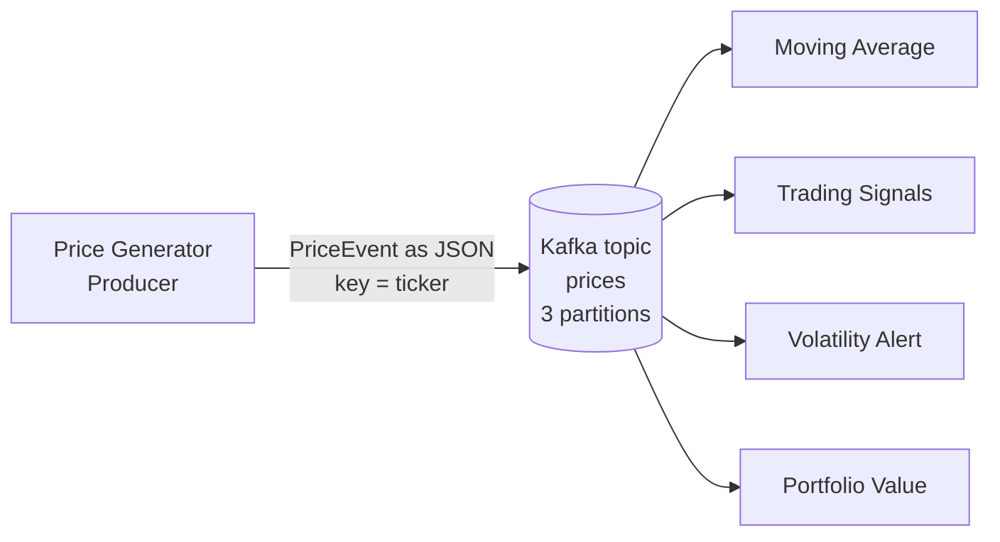

# kafka-market-stream
 
Real-time market data pipeline built with **Java** and **Apache Kafka**.
 
A price generator continuously publishes stock prices to Kafka. Several independent consumers analyse the same stream live, for example moving averages, trading signals, volatility alerts and portfolio value.
 
This project is the streaming counterpart to my Python batch pipeline: instead of loading data once and processing it, events are handled the moment they arrive.
 
> **Work in progress.** Built step by step as a learning project. See the [roadmap](#roadmap) for the current status.
 
## Architecture
 

 
| Decision | Choice | Reason |
|---|---|---|
| Topics | one topic `prices` for all stocks | adding a new stock requires no consumer changes |
| Partitions | 3 | allows parallel consumers within a consumer group |
| Message key | ticker (e.g. `AAPL`) | all events of one stock land in the same partition, so their order is preserved |
| Message format | JSON | fields are named, so new fields don't break existing consumers |
| Consumers | one consumer group per analysis | every analysis receives the full stream |
 
### Event
 
```json
{"ticker":"AAPL","timestamp":"2026-10-27T12:39:33.837Z","price":256.9}
```
 
Modelled in Java as an immutable `record PriceEvent(String ticker, Instant timestamp, double price)`. Timestamps are stored in UTC.
 
## Tech stack
 
- Java 25
- Apache Kafka (single broker via Docker, KRaft mode)
- Maven
- Jackson 3 (JSON serialization)
- Docker Compose
- GitHub Codespaces
## Getting started
 
Requirements: Docker, Java 17+, Maven. Everything is preinstalled in GitHub Codespaces.
 
**1. Start Kafka**
 
```bash
docker compose up -d
docker ps   # STATUS should show "Up"
```
 
**2. Create the topic**
 
```bash
docker exec -it kafka-market-stream-kafka-1 /opt/kafka/bin/kafka-topics.sh --create --topic prices --partitions 3 --bootstrap-server localhost:9092
```
 
**3. Run the application**
 
```bash
mvn compile exec:java -Dexec.mainClass=de.tien.App
```
 
**4. Watch the stream** (in a second terminal)
 
```bash
docker exec -it kafka-market-stream-kafka-1 /opt/kafka/bin/kafka-console-consumer.sh --topic prices --bootstrap-server localhost:9092 --from-beginning
```
 
## Roadmap
 
| Phase | Content | Status |
|---|---|---|
| 0 | Repository, Codespace | done |
| 1 | Kafka via Docker, topic setup, manual send/receive via CLI | done |
| 2 | Java producer: price generator | in progress |
| 3 | Java consumer: moving average | planned |
| 4 | Experiments: consumer groups, partitions, keys | planned |
| 5 | More analyses: signals, alerts, portfolio value, possibly real market data | planned |
 
## Project structure
 
```
kafka-market-stream/
├── docker-compose.yml          # Kafka broker
├── pom.xml                     # Maven build and dependencies
└── src/main/java/de/tien/
    ├── App.java                # entry point
    └── PriceEvent.java         # event model
```
 
